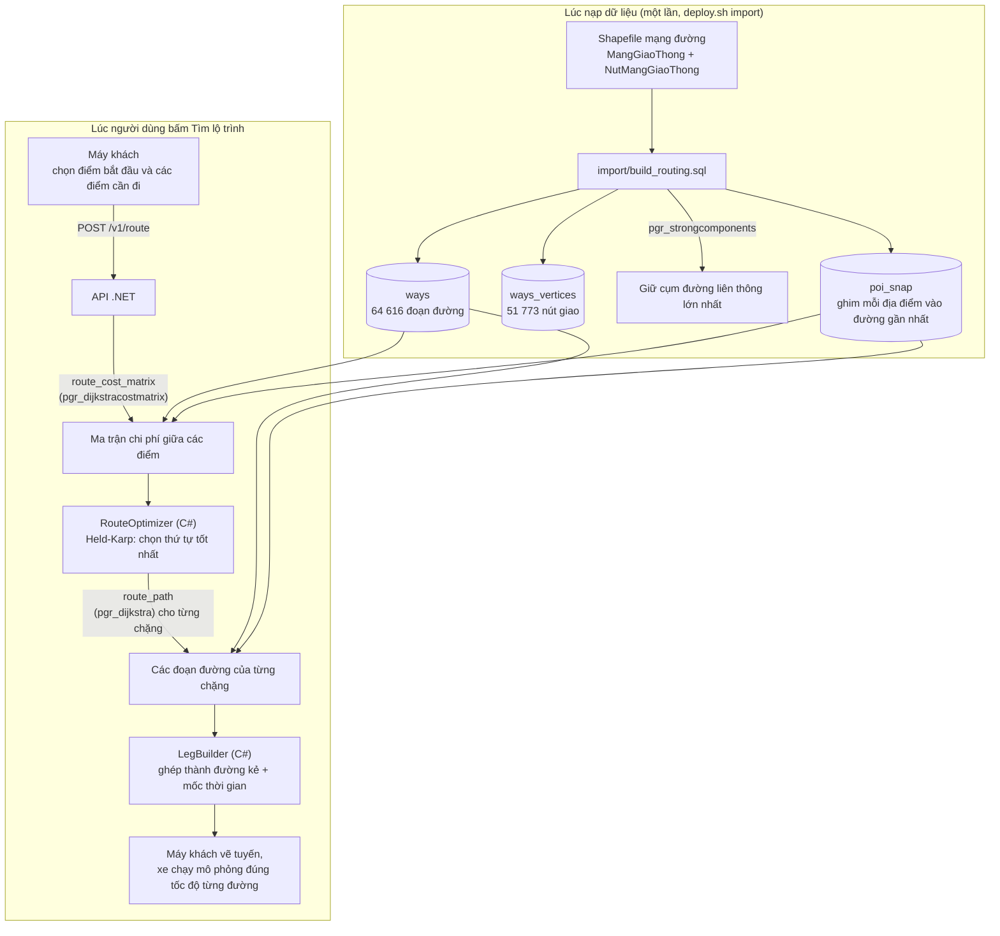
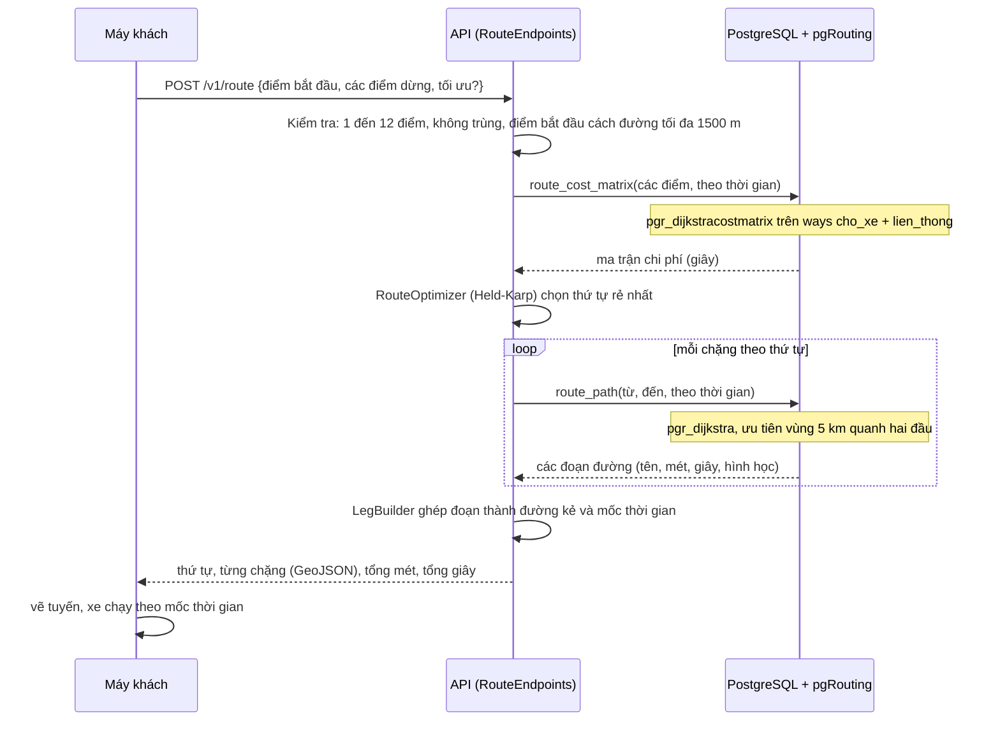

# pgRouting trong Hue Travel

pgRouting là phần mở rộng của PostgreSQL biến cơ sở dữ liệu thành **bộ máy tìm đường**: cho một mạng đường (đồ thị), nó
tìm được đường đi rẻ nhất giữa hai điểm. Trong dự án, mọi phép "đi từ A đến B bằng đường bộ thật" đều do pgRouting tính
ngay trong cơ sở dữ liệu; máy khách chỉ nhận kết quả để vẽ.

Mục lục: [1. Vai trò](#1-pgrouting-làm-gì-và-không-làm-gì) · [2. Bức tranh tổng thể](#2-bức-tranh-tổng-thể) ·
[3. Dữ liệu đầu vào](#3-dữ-liệu-đầu-vào-mạng-đường) · [4. Các hàm đang dùng](#4-các-hàm-pgrouting-đang-dùng) ·
[5. Một yêu cầu đi qua hệ thống](#5-một-yêu-cầu-tìm-đường-đi-qua-hệ-thống-thế-nào) · [6. Ví dụ thật](#6-ví-dụ-cụ-thể-trên-dữ-liệu-của-dự-án) ·
[7. Hiệu năng](#7-hiệu-năng-và-các-mẹo-đã-áp-dụng) · [8. Giới hạn](#8-giới-hạn-cần-biết) · [9. Tự chạy thử](#9-tự-chạy-thử)

---

## 1. pgRouting làm gì và không làm gì

| pgRouting **làm** | pgRouting **không làm** (do phần khác của dự án) |
|---|---|
| Tìm đường rẻ nhất giữa hai nút giao (thuật toán Dijkstra) | **Chọn thứ tự thăm các điểm**: việc này do `Routing/RouteOptimizer.cs` (quy hoạch động Held-Karp, tối đa 12 điểm) |
| Tính bảng chi phí giữa mọi cặp điểm (ma trận chi phí) | Vẽ tuyến lên bản đồ: máy khách làm bằng MapWinGIS |
| Tìm các cụm đường nối được với nhau (thành phần liên thông mạnh) | Sinh dữ liệu đường: đến từ OpenStreetMap, nạp bằng `run.sh` |
| Tôn trọng đường **một chiều** nhờ chi phí hai chiều khác nhau | Dự báo kẹt xe: chi phí chỉ theo độ dài và tốc độ ước lượng theo loại đường |

"Chi phí" có thể là **mét** (đường ngắn nhất) hoặc **giây** (đường nhanh nhất). Ứng dụng mặc định dùng **giây**.

---

## 2. Bức tranh tổng thể



---

## 3. Dữ liệu đầu vào: mạng đường

Mạng đường được mô hình hóa thành **đồ thị**: mỗi giao lộ là một **nút** (`ways_vertices`), mỗi đoạn đường giữa hai giao lộ là một
**cạnh** (`ways`). Các cột quan trọng với pgRouting:

| Cột (`ways`) | Ý nghĩa với pgRouting |
|---|---|
| `gid` | Mã cạnh (`id` mà pgRouting yêu cầu) |
| `source`, `target` | Nút đầu và nút cuối của cạnh |
| `cost` | Chi phí đi **xuôi** chiều vẽ, tính bằng **mét** |
| `reverse_cost` | Chi phí đi **ngược** chiều; **số âm = cấm đi ngược** (đường một chiều) |
| `cost_time`, `reverse_cost_time` | Hai chi phí trên đổi sang **giây** = mét ÷ (tốc độ m/s) |
| `cho_xe` | Chỉ các đoạn xe cơ giới đi được mới đưa vào đồ thị |
| `lien_thong` | Chỉ đoạn thuộc mạng liên thông lớn nhất mới được tìm đường trên đó |

`import/build_routing.sql` dựng đồ thị từ shapefile qua các bước:

1. **Chép cạnh**, bỏ cạnh quay về chính nó hoặc dài 0. Chi phí ban đầu là chiều dài hình học (`st_length`).
2. **Một chiều:** nếu dữ liệu đóng một chiều, chi phí chiều đó đặt `-1`.
3. **Tốc độ theo loại đường.** Dữ liệu ghi `maxspeed = 30` gần như khắp nơi (giá trị giữ chỗ), nên dự án dùng tốc độ điển hình của từng loại đường và chỉ tin `maxspeed` khi lớn hơn 30:

   | Loại đường | Tốc độ dùng |
   |---|---|
   | Cao tốc | 80 km/h |
   | Trục chính, chính cấp 1 | 50 km/h |
   | Chính cấp 2 | 40 km/h |
   | Chính cấp 3 | 35 km/h |
   | Đường chưa phân cấp | 30 km/h |
   | Khu dân cư, đường nội bộ | 25 km/h |
   | Đường chuyên dụng | 20 km/h |
   | Đường đi bộ, bậc thang, đường xe đạp | **không cho xe** (`cho_xe = false`) |

4. **Thời gian:** `cost_time = cost ÷ (tốc độ ÷ 3,6)`, âm thì giữ âm.
5. **Chỉ giữ mạng liên thông mạnh lớn nhất** bằng `pgr_strongcomponents` (xem mục 4), để mọi địa điểm đều có đường tới mọi địa điểm khác.
6. **Ghim địa điểm** vào đường gần nhất (`poi_snap`).

Số liệu thực tế của dữ liệu hiện tại:

| Đại lượng | Giá trị |
|---|---|
| Tổng số đoạn đường (`ways`) | 64 616 |
| Đoạn cho xe cơ giới đi | 61 975 |
| Đoạn thuộc mạng liên thông lớn (dùng để tìm đường) | 61 808 |
| Tổng số nút giao | 51 773 |
| Nút thuộc mạng liên thông lớn | 49 771 (phần còn lại rải rác ở khoảng 130 cụm nhỏ, bị loại) |

---

## 4. Các hàm pgRouting đang dùng

Dự án chỉ dùng **ba** hàm của pgRouting, mỗi hàm một việc:

| Hàm pgRouting | Dùng ở đâu | Việc làm |
|---|---|---|
| `pgr_strongcomponents` | `import/build_routing.sql` (một lần khi nạp dữ liệu) | Chia đồ thị thành các **cụm liên thông mạnh**: trong một cụm, từ nút nào cũng đi được tới nút khác, kể cả khi có đường một chiều. Dự án giữ cụm lớn nhất. Dùng "mạnh" thay vì "yếu" để loại các **ngõ cụt một chiều** (vào được mà không ra được) |
| `pgr_dijkstracostmatrix` | hàm SQL `route_cost_matrix(ids, theo_thời_gian)` (migration V004) | Cho một danh sách nút, trả về **chi phí từ mọi nút tới mọi nút khác** trong một lần gọi |
| `pgr_dijkstra` | `route_path` (V004), `route_path_from_vertex` (V008), `route_path_from_point` (V009) | Trả về **danh sách từng cạnh** của đường rẻ nhất giữa hai nút, theo thứ tự đi |

Bao quanh chúng là các hàm SQL do dự án viết để dùng chung một cách:

| Hàm của dự án | Việc làm |
|---|---|
| `route_cost_matrix(ids, theo_thời_gian)` | Ma trận chi phí giữa các **địa điểm** (tối đa 50). Bên trong: đổi địa điểm thành nút (qua `poi_snap`) rồi gọi `pgr_dijkstracostmatrix` |
| `route_path(từ, đến, theo_thời_gian)` | Đường đi giữa hai **địa điểm**, mỗi cạnh một dòng: `seq`, tên đường, mét, giây, hình học đã **quay theo chiều đi** |
| `snap_point(x, y)` | Ghim một **điểm bất kỳ** (ví dụ điểm bắt đầu chọn trên bản đồ) vào **chính đoạn đường** gần nhất, cho biết điểm nằm ở vị trí bao nhiêu phần của đoạn |
| `route_cost_from_point(x, y, ids, …)` | Chi phí từ điểm bất kỳ đó tới các địa điểm |
| `route_path_from_point(x, y, địa_điểm, …)` | Đường đi từ điểm bất kỳ tới một địa điểm; chặng đầu gồm một đoạn nối ngắn từ điểm ra đường |

---

## 5. Một yêu cầu tìm đường đi qua hệ thống thế nào

Người dùng chọn điểm bắt đầu và vài điểm cần đến, bấm tìm lộ trình:



Nếu điểm bắt đầu là một điểm chọn tùy ý trên bản đồ thay vì một địa điểm, API dùng bản `route_cost_from_point` /
`route_path_from_point`; cách hoạt động ở ví dụ 5 bên dưới.

---

## 6. Ví dụ cụ thể trên dữ liệu của dự án

Các số dưới đây là kết quả chạy thật các hàm trên cơ sở dữ liệu của dự án (190 địa điểm thật, đo ngày 15/10/2026).
Địa điểm dùng làm ví dụ:

| Mã | Tên |
|---|---|
| `DL021` | Đại Nội Huế |
| `DL024` | Chùa Thiên Mụ |
| `DL029` | Lăng Tự Đức |
| `DL033` | Lăng Khải Định |
| `DL039` | Cầu Trường Tiền |

### Ví dụ 1. Ghim địa điểm vào mạng đường (`poi_snap`)

Địa điểm không nằm đúng trên đường, nên mỗi địa điểm được nối vào nút giao của con đường gần nhất:

| Địa điểm | Cách đường gần nhất | Cách nút giao vào đồ thị | Nút | Xa đường (>150 m)? |
|---|--:|--:|--:|:-:|
| Đại Nội Huế (`DL021`) | 226,5 m | 226,7 m | 28489 | **có** |
| Chùa Thiên Mụ (`DL024`) | 23,3 m | 36,5 m | 35375 | không |
| Lăng Tự Đức (`DL029`) | 125,0 m | 125,0 m | 2214 | không |
| Lăng Khải Định (`DL033`) | 62,3 m | 62,8 m | 28149 | không |
| Cầu Trường Tiền (`DL039`) | 76,7 m | 160,5 m | 31107 | không |

Đại Nội nằm sâu trong Kinh thành nên cách đường lớn tới 226 m; vì vậy cột `xa_duong` bằng `true` để ứng dụng cảnh báo kết
quả chỉ mang tính ước lượng. Toàn bộ dữ liệu có 15 trên 190 địa điểm ở trường hợp này.

### Ví dụ 2. Ma trận chi phí (`pgr_dijkstracostmatrix`)

```sql
select from_id, to_id, round(cost) from route_cost_matrix(array['DL021','DL024','DL029'], true);
```

| Từ | Đến | Thời gian (giây) | Quãng đường (mét) |
|---|---|--:|--:|
| Đại Nội | Thiên Mụ | 408 | 4 373 |
| Thiên Mụ | Đại Nội | 459 | 4 669 |
| Đại Nội | Tự Đức | 677 | 5 555 |
| Tự Đức | Đại Nội | 702 | 6 027 |
| Thiên Mụ | Tự Đức | 440 | 3 781 |
| Tự Đức | Thiên Mụ | 440 | 3 781 |

Hai điểm đáng chú ý: **đi và về không bằng nhau** (Đại Nội → Thiên Mụ 4 373 m, chiều ngược lại 4 669 m) vì trên đường có
đoạn một chiều, và **đường nhanh nhất chưa chắc là đường ngắn nhất** nên dự án có sẵn cả hai loại chi phí.

### Ví dụ 3. Đường đi cụ thể (`pgr_dijkstra`)

```sql
select seq, ten, round(length_m) as met, round(seconds) as giay from route_path('DL021','DL024', true);
```

Từ Đại Nội đến Chùa Thiên Mụ: **69 đoạn đường, 4 373 m, 408 giây (khoảng 6,8 phút)**, đi qua các tuyến Trần Bình Trọng,
Nguyễn Trãi, Bùi Thị Xuân, Lê Duẩn, Kim Long, cầu Cửa Nhà Đồ, cầu Nguyễn Hoàng. Tám dòng đầu:

| seq | Tên đường | Mét | Giây |
|--:|---|--:|--:|
| 1 | Trần Bình Trọng | 59 | 8 |
| 2 | Trần Bình Trọng | 5 | 1 |
| 3 | Trần Bình Trọng | 43 | 6 |
| 4 | Trần Bình Trọng | 9 | 1 |
| 5 | Trần Bình Trọng | 9 | 1 |
| 6 | Trần Bình Trọng | 58 | 8 |
| 7 | Nguyễn Trãi | 3 | 0 |
| 8 | Nguyễn Trãi | 87 | 8 |

Một con đường được chia thành nhiều đoạn ngắn giữa các giao lộ nên cùng một tên lặp lại nhiều dòng. `LegBuilder` nối 69 đoạn
này thành **một đường kẻ duy nhất** kèm mốc thời gian tại từng điểm, để xe mô phỏng chạy nhanh chậm đúng theo từng loại đường.

### Ví dụ 4. Chọn thứ tự thăm: pgRouting cho chi phí, C# chọn thứ tự

Xuất phát từ **Cầu Trường Tiền**, cần ghé 4 nơi: Đại Nội, Thiên Mụ, Tự Đức, Khải Định. Có 24 thứ tự khả dĩ. Ma trận chi
phí từ `route_cost_matrix` cho phép tính tổng thời gian của từng thứ tự:

| Thứ tự | Tổng thời gian |
|---|--:|
| Tốt nhất: Đại Nội → Thiên Mụ → Tự Đức → Khải Định | **29 phút** |
| Tệ nhất trong 24 thứ tự | **51 phút** |

Chọn đúng thứ tự tiết kiệm **22 phút** (khoảng 43%) cho cùng bốn điểm đến. Với 12 điểm có hơn 479 triệu thứ tự, nên
`RouteOptimizer` dùng quy hoạch động Held-Karp thay vì thử hết; pgRouting chỉ cần cung cấp một ma trận 13 × 13.

### Ví dụ 5. Điểm bắt đầu chọn tự do trên bản đồ

Người dùng bấm một điểm cách Cầu Trường Tiền 40 m về phía đông. Điểm này không có trong `poi_snap`, nên dùng `snap_point`:

```sql
select * from snap_point(776248.7, 1822585.3);   -- tọa độ VN-2000 / UTM 48N, mét
```

Kết quả: đoạn đường số **8323** (nút 30876 → 31107, dài 408 m); điểm chiếu lên đường ở vị trí **0,727** (72,7% chiều dài từ nút
đầu) và cách đường 49,7 m. Hàm `route_cost_from_point` rồi tính chi phí tới các địa điểm:

| Đến | Thời gian từ điểm vừa bấm |
|---|--:|
| Đại Nội | 197 giây |
| Thiên Mụ | 501 giây |
| Tự Đức | 616 giây |

Điểm quan trọng (migration V009): điểm bắt đầu **vào đồ thị ngay trên đoạn đường**, không "nhảy" tới nút giao gần nhất.
Một điểm nằm giữa đoạn đường dài 408 m chỉ phải đi phần đường thật sự cần, và hàm thử cả hai đầu đoạn rồi chọn đầu rẻ hơn, có
tính đến đường một chiều. Chặng đầu của đường đi (`seq = 0`) gồm đoạn nối ngắn từ điểm bấm ra đường (tính ở khoảng 6 m/s) và phần
đoạn đường tới giao lộ rời đi.

---

## 7. Hiệu năng và các mẹo đã áp dụng

Đo trên máy phát triển, một lần chạy (số tham khảo, có thể khác nhau giữa các lần):

| Phép tính | Thời gian |
|---|--:|
| `route_path` giữa hai địa điểm (Ví dụ 3) | khoảng 100 ms |
| `route_cost_matrix` cho 5 địa điểm | khoảng 135 ms |

Những cách để đồ thị 60 nghìn cạnh vẫn trả lời nhanh:

- **Chỉ đưa vào đồ thị những gì cần:** điều kiện `cho_xe and lien_thong` loại cạnh đi bộ và cụm đường nhỏ ngay từ câu truy vấn.
- **Giới hạn vùng tìm** trong `route_path`: trước hết chỉ xét các cạnh trong hộp 5 km quanh hai đầu (`geom && st_expand(...)`); nếu không
  ra đường thì mới thử toàn mạng.
- **Chỉ mục:** GiST trên `geom`, B-tree trên `source`, `target`, và chỉ mục riêng cho các cạnh `cho_xe and lien_thong`.
- **Tính ma trận một lần** cho cả danh sách điểm thay vì gọi từng cặp.
- **Nạp lại dữ liệu an toàn:** `build_routing.sql` dùng `DELETE` thay `TRUNCATE` để các yêu cầu đang chạy không bị khóa, người dùng
  vẫn thấy đồ thị cũ cho tới khi giao dịch kết thúc.
- **Giới hạn chặn quá tải:** tối đa 50 địa điểm cho ma trận (công việc tăng theo bình phương), 12 điểm dừng trên giao diện, và
  giới hạn 30 yêu cầu tìm đường mỗi phút cho mỗi máy khách.

---

## 8. Giới hạn cần biết

- **Tốc độ là ước lượng theo loại đường**, không có dữ liệu giao thông thực, đèn đỏ hay cấm rẽ; thời gian chỉ mang tính tham khảo.
- **Chỉ xe cơ giới.** Không có chế độ đi bộ hay xe đạp, vì các loại đường đó bị loại khỏi đồ thị.
- **Địa điểm xa đường** (hơn 150 m, như Đại Nội) vẫn tìm được đường nhưng thời gian đi bộ từ cổng ra đường chưa được tính chính xác.
- **Điểm bắt đầu tự chọn** cách đường hơn 1 500 m bị từ chối.
- **Phạm vi:** chỉ trong vùng dữ liệu mạng đường đã nạp (khu vực Huế).
- Đổi dữ liệu đường phải chạy lại bước nạp (`deploy.sh import`); đồ thị **không tự cập nhật** khi dữ liệu nguồn đổi.

---

## 9. Tự chạy thử

Vào cơ sở dữ liệu (`psql`) của máy chủ và thử các lệnh sau (mã địa điểm lấy từ bảng `poi`):

```sql
-- đồ thị có bao nhiêu cạnh, nút
select count(*) from ways;            -- đoạn đường
select count(*) from ways_vertices;   -- nút giao

-- địa điểm nào xa đường nhất
select poi_id, round(dist_m) from poi_snap order by dist_m desc limit 5;

-- ma trận chi phí (giây) giữa 3 địa điểm
select * from route_cost_matrix(array['DL021','DL024','DL029'], true);

-- đường đi chi tiết và tổng thời gian
select count(*), round(sum(length_m)) as met, round(sum(seconds)) as giay from route_path('DL021','DL024', true);

-- gọi trực tiếp một hàm pgRouting trên đồ thị của dự án
-- (trả 70 dòng: 69 đoạn đường và một dòng kết thúc có edge = -1; cột agg_cost của dòng cuối là tổng 408 giây)
select * from pgr_dijkstra(
    'select gid as id, source, target, cost_time as cost, reverse_cost_time as reverse_cost from ways where cho_xe and lien_thong',
    28489, 35375, true);
```

Từ điển ngắn: **Dijkstra** là thuật toán tìm đường rẻ nhất trên đồ thị có chi phí không âm; **liên thông mạnh** nghĩa là từ nút này đi
được tới nút kia và ngược lại; **ghim (snap)** là gắn một điểm bất kỳ vào vị trí gần nhất trên mạng đường.
Các hàm SQL của dự án nằm trong `may-chu/co-so-du-lieu/migrations/V004`, `V008`, `V009`; bước dựng đồ thị nằm ở
`may-chu/co-so-du-lieu/import/build_routing.sql`; phần gọi từ API nằm ở `may-chu/api/Routing/`.
