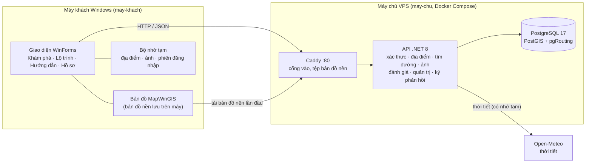
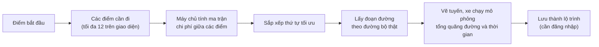
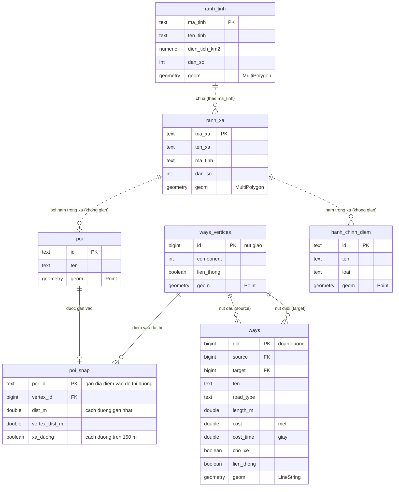
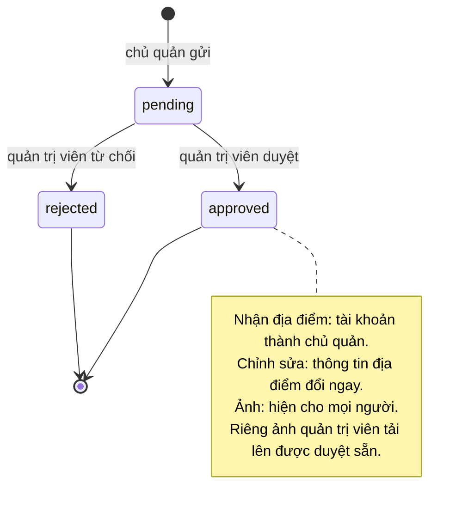

# Sơ đồ tổng quan Hue Travel

Các sơ đồ dưới đây viết bằng [Mermaid](https://mermaid.js.org/), GitHub tự vẽ khi mở tệp này. Muốn xem chi tiết từng
bảng và từng API, đọc [tai-lieu-du-lieu.md](tai-lieu-du-lieu.md); muốn biết cách chia hai phần cài đặt, đọc
[phan-chia-may-chu-may-khach.md](phan-chia-may-chu-may-khach.md).

Mục lục: [1. Kiến trúc](#1-kiến-trúc-hệ-thống) · [2. Phân rã chức năng](#2-sơ-đồ-phân-rã-chức-năng) ·
[3. Ai làm được gì](#3-ai-làm-được-gì) · [4. Cơ sở dữ liệu](#4-sơ-đồ-cơ-sở-dữ-liệu) · [5. Vòng đời duyệt](#5-vòng-đời-các-yêu-cầu-cần-duyệt)

---

## 1. Kiến trúc hệ thống

Máy khách chỉ lo giao diện và vẽ bản đồ; mọi dữ liệu dùng chung, tài khoản và tìm đường nằm trên máy chủ.

Hệ tọa độ thống nhất: **VN-2000 / UTM 48N (EPSG:3405)**, đơn vị mét.

---

## 2. Sơ đồ phân rã chức năng

### 2.1. Toàn hệ thống

```mermaid
flowchart LR
    ROOT(["Hue Travel"])

    ROOT --> A["A. Bản đồ và tìm kiếm"]
    ROOT --> B["B. Lộ trình"]
    ROOT --> C["C. Hướng dẫn du lịch"]
    ROOT --> D["D. Tài khoản và hồ sơ"]
    ROOT --> E["E. Chủ quản địa điểm"]
    ROOT --> F["F. Quản trị"]
    ROOT --> G["G. Nền tảng máy chủ"]

    A --> A1["Bản đồ nền: đường, sông, ranh giới<br/>tỉnh, xã, tên địa danh"]
    A --> A2["Tìm địa điểm theo tên không dấu<br/>và lọc theo 6 nhóm"]
    A --> A3["Thẻ thông tin địa điểm<br/>ảnh · giờ mở · giá · liên hệ"]
    A --> A4["Công cụ: phóng/thu, kéo,<br/>nhận dạng, đo khoảng cách, đo diện tích"]
    A --> A5["Lớp dữ liệu, đổi bản đồ nền"]
    A --> A6["Thanh trạng thái: tên xã đang xem,<br/>tọa độ, tỉ lệ, thời tiết"]

    B --> B1["Chọn điểm bắt đầu<br/>gợi ý từ danh sách, không gõ tọa độ"]
    B --> B2["Chọn các điểm cần đi"]
    B --> B3["Tìm thứ tự tối ưu<br/>theo thời gian hoặc quãng đường"]
    B --> B4["Vẽ tuyến theo đường bộ thật<br/>xe chạy mô phỏng"]
    B --> B5["Lưu và mở lại lộ trình"]

    C --> C1["Tour dựng sẵn: bấm là chạy"]
    C --> C2["Nội dung hướng dẫn<br/>viết sẵn trong ứng dụng"]

    D --> D1["Đăng ký, chọn loại tài khoản<br/>đăng nhập, đổi mật khẩu"]
    D --> D2["Địa điểm yêu thích"]
    D --> D3["Lộ trình đã lưu"]
    D --> D4["Đánh giá và nhận xét<br/>Đánh giá của tôi"]
    D --> D5["Báo sai thông tin"]

    E --> E1["Xin quản lý địa điểm"]
    E --> E2["Đề nghị sửa thông tin<br/>chờ quản trị duyệt"]
    E --> E3["Tải ảnh địa điểm<br/>chờ quản trị duyệt"]
    E --> E4["Trả lời đánh giá"]
    E --> E5["Đăng thông báo"]
    E --> E6["Xem thống kê lượt xem"]

    F --> F1["Tổng quan số việc đang chờ"]
    F --> F2["Chờ duyệt: chủ quản, chỉnh sửa, ảnh"]
    F --> F3["Người dùng: đổi vai trò, khóa<br/>đặt lại mật khẩu, xóa"]
    F --> F4["Địa điểm: sửa, thêm, xóa, ảnh<br/>nhập CSV/GeoJSON"]
    F --> F5["Kiểm duyệt: ẩn đánh giá,<br/>xử lý báo sai"]
    F --> F6["Nhật ký thay đổi"]

    G --> G1["Xác thực: JWT 15 phút<br/>mã làm mới, khóa sau 5 lần sai"]
    G --> G2["Tìm đường: pgRouting<br/>ma trận chi phí tối đa 50 điểm"]
    G --> G3["Ký phản hồi ECDSA P-256<br/>giới hạn tốc độ"]
    G --> G4["Cung cấp bản đồ nền<br/>và cấu hình cho máy khách"]
    G --> G5["Nhật ký kiểm toán<br/>mọi thay đổi dữ liệu dùng chung"]
```

### 2.2. Chi tiết luồng "Lộ trình"

---

## 3. Ai làm được gì

Khi đã cấu hình địa chỉ máy chủ, ứng dụng yêu cầu đăng nhập hoặc đăng ký ngay khi mở. Chưa có địa chỉ máy chủ thì ứng dụng
chạy **ngoại tuyến** (không có tài khoản, chỉ xem bản đồ và địa điểm đi kèm). Giao diện hiện đúng chức năng theo vai trò
của tài khoản đang đăng nhập.

| Chức năng | Người dùng | Chủ quản | Quản trị viên |
|---|:-:|:-:|:-:|
| Xem bản đồ, tìm địa điểm, thời tiết, đo đạc | ✔ | ✔ | ✔ |
| Lập lộ trình, dùng Hướng dẫn | ✔ | ✔ | ✔ |
| Đọc đánh giá và ảnh đã duyệt | ✔ | ✔ | ✔ |
| Yêu thích, lưu lộ trình | ✔ | ✔ | ✔ |
| Viết, sửa, xóa đánh giá của mình | ✔ | ✔ (trừ địa điểm của mình) | ✔ |
| Báo sai thông tin | ✔ | ✔ | ✔ |
| Xin quản lý địa điểm (hoặc chọn khi đăng ký) | ✔ | ✔ | |
| Sửa thông tin, tải ảnh, trả lời đánh giá, đăng thông báo, xem thống kê | | ✔ (địa điểm của mình) | ✔ |
| Duyệt chủ quản, chỉnh sửa, ảnh | | | ✔ |
| Quản lý người dùng (đổi vai trò, khóa, đặt lại mật khẩu, xóa) | | | ✔ |
| Sửa, thêm, xóa địa điểm; nhập từ tệp | | | ✔ |
| Ẩn đánh giá, xử lý báo sai, xem nhật ký | | | ✔ |

---

## 4. Sơ đồ cơ sở dữ liệu

Cơ sở dữ liệu có **hai nhóm bảng**: nhóm *tài khoản và nội dung* (do người dùng tạo ra) và nhóm *địa lý và đường đi*
(dữ liệu bản đồ). Hai nhóm gặp nhau ở bảng `poi` (địa điểm). Định nghĩa đầy đủ nằm ở
[`may-chu/co-so-du-lieu/migrations`](../may-chu/co-so-du-lieu/migrations).

### 4.1. Tài khoản, địa điểm và nội dung

```mermaid
erDiagram
    app_user {
        bigint id PK
        citext username UK "3-40 ky tu, khong phan biet hoa thuong"
        text password_hash "bcrypt"
        text display_name
        text role "user | owner | admin"
        text status "active | locked | must_change_password"
        int failed_logins
        timestamptz locked_until
        timestamptz last_login_at
    }
    refresh_token {
        bigint id PK
        bigint user_id FK
        bytea token_hash UK "chi luu SHA-256"
        timestamptz expires_at
        timestamptz revoked_at
    }
    poi {
        text id PK "vi du DL021"
        text nhom "heritage scenery food stay service transport"
        text ten
        text ten_khong_dau "tim kiem khong dau"
        text dia_chi
        text gio_mo_cua
        text gia_text
        text sdt
        text website
        text mo_ta
        text status "visible | hidden | closed"
        int version
        geometry geom "Point EPSG 3405"
    }
    place_owner {
        bigint user_id PK
        text poi_id PK
        text status "pending | approved | rejected"
        bigint reviewed_by FK
    }
    poi_edit_request {
        bigint id PK
        text poi_id FK
        bigint user_id FK
        jsonb changes "chi cac cot chu quan duoc sua"
        text status "pending | approved | rejected"
    }
    poi_photo {
        bigint id PK
        text poi_id FK
        bytea data "JPEG toi da 1600 px"
        text status "pending | approved | rejected"
        smallint position
        bigint uploaded_by FK
    }
    announcement {
        bigint id PK
        text poi_id FK
        text title
        text body
        timestamptz ends_at
        bigint created_by FK
    }
    review {
        bigint id PK
        bigint user_id FK
        text poi_id FK
        smallint rating "1 den 5"
        text comment
        text status "visible | hidden"
        text owner_reply
    }
    report {
        bigint id PK
        bigint user_id FK
        text poi_id FK
        text kind "wrong_info closed wrong_location other"
        text status "open | resolved"
    }
    favorite {
        bigint user_id PK
        text poi_id PK
    }
    itinerary {
        bigint id PK
        bigint user_id FK
        text name
    }
    itinerary_item {
        bigint itinerary_id PK
        int position PK
        text poi_id FK
    }
    poi_stats_daily {
        text poi_id PK
        date day PK
        int views
        int route_adds
    }
    audit_log {
        bigint id PK
        bigint user_id FK
        text action
        text entity
        text entity_id
        jsonb old_value
        jsonb new_value
    }

    app_user ||--o{ refresh_token : "co"
    app_user ||--o{ place_owner : "quan ly"
    poi ||--o{ place_owner : "co chu quan"
    app_user ||--o{ poi_edit_request : "de nghi sua"
    poi ||--o{ poi_edit_request : "duoc sua"
    app_user ||--o{ poi_photo : "tai len"
    poi ||--o{ poi_photo : "co anh"
    poi ||--o{ announcement : "co thong bao"
    app_user ||--o{ review : "viet"
    poi ||--o{ review : "nhan"
    app_user ||--o{ report : "gui"
    poi ||--o{ report : "bi bao"
    app_user ||--o{ favorite : "luu"
    poi ||--o{ favorite : "duoc luu"
    app_user ||--o{ itinerary : "lap"
    itinerary ||--|{ itinerary_item : "gom"
    poi ||--o{ itinerary_item : "nam trong"
    poi ||--o{ poi_stats_daily : "thong ke"
    app_user ||--o{ audit_log : "thuc hien"
```

Một số quy tắc đáng nhớ:

- Mỗi người chỉ có **một đánh giá cho mỗi địa điểm** (`review` có ràng buộc duy nhất `user_id + poi_id`).
- Xóa người dùng hoặc địa điểm sẽ xóa kèm dữ liệu của họ (yêu thích, lộ trình, đánh giá…); riêng `audit_log` giữ lại dòng, chỉ bỏ liên kết tới người đã xóa.
- Ảnh lưu thẳng trong cơ sở dữ liệu (cột `bytea`), nên nằm trong mọi bản sao lưu.
- Địa điểm bị "xóa" chỉ được đánh dấu `deleted_at`, không mất khỏi bảng.

### 4.2. Dữ liệu địa lý và đường đi

Các bảng này là dữ liệu bản đồ, nạp một lần bằng `deploy.sh import`. Chúng nối với nhau bằng **quan hệ không gian**
(điểm nằm trong xã nào, nằm gần đường nào), không phải khóa ngoại; chỉ `poi_snap` có khóa ngoại thật.

Cách tìm đường: mỗi địa điểm được "gắn" (`poi_snap`) vào nút giao gần nhất của mạng đường đi xe; hàm
`route_cost_matrix` tính chi phí giữa các cặp điểm trên đồ thị `ways` / `ways_vertices` bằng pgRouting, rồi máy chủ sắp xếp
thứ tự và lấy hình học từng đoạn (`route_path`).

---

## 5. Vòng đời các yêu cầu cần duyệt

Ba loại yêu cầu (nhận địa điểm, đề nghị sửa, ảnh) đều đi qua quản trị viên và đều có cùng ba trạng thái.

Đánh giá thì khác: hiện ngay khi viết (`visible`); quản trị viên có thể ẩn (`hidden`) nếu vi phạm.
Tài khoản có vòng đời riêng: `active` ↔ `locked` (vô hiệu hóa) và `must_change_password` sau khi quản trị viên đặt lại
mật khẩu; chỉ tài khoản đang `locked` mới xóa được.
