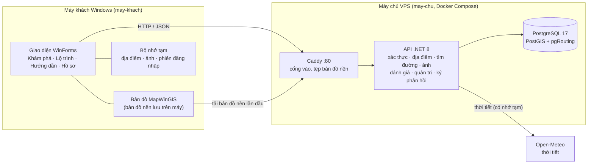
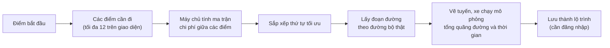
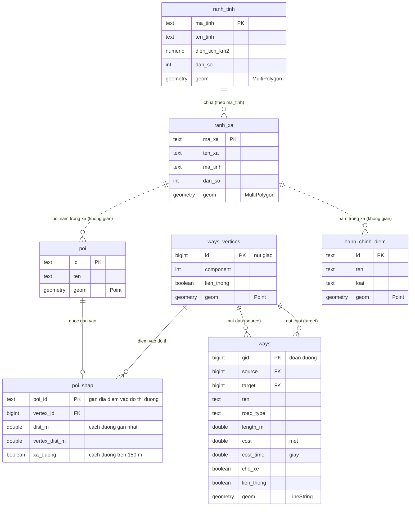
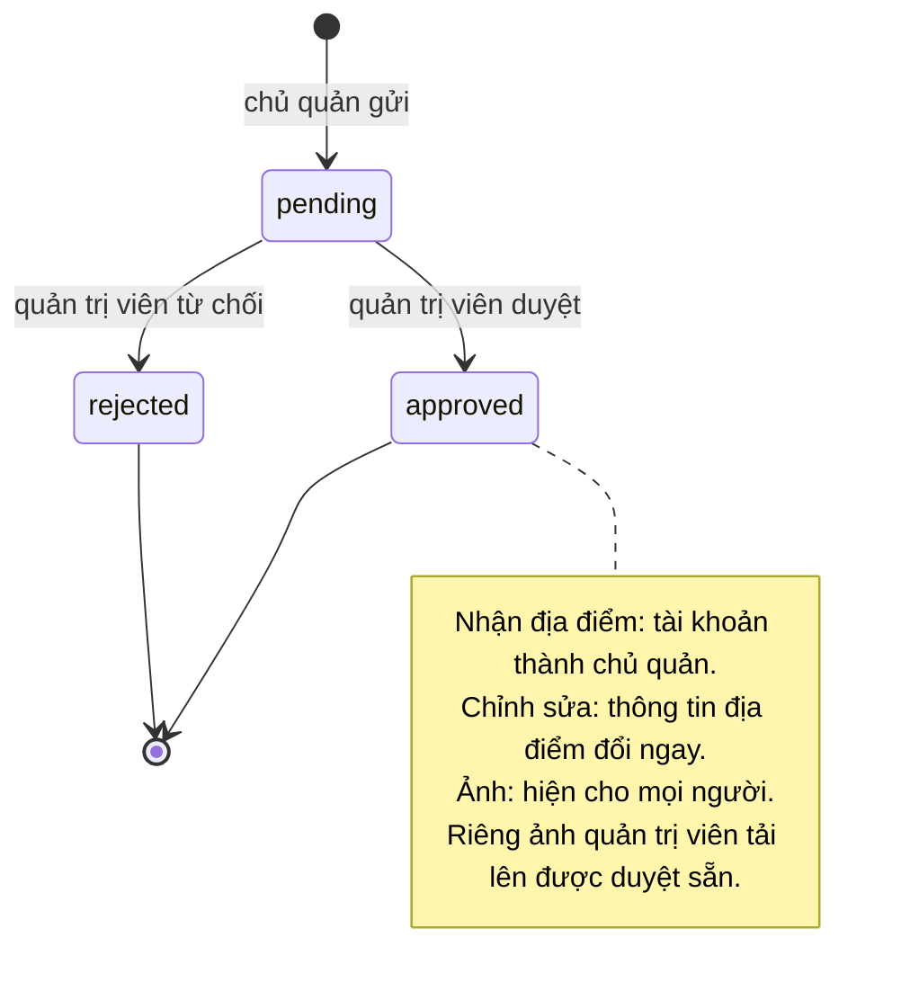

# Sơ đồ tổng quan Hue Travel

Các sơ đồ dưới đây viết bằng [Mermaid](https://mermaid.js.org/), GitHub tự vẽ khi mở tệp này. Muốn xem chi tiết từng
bảng và từng API, đọc [tai-lieu-du-lieu.md](tai-lieu-du-lieu.md); muốn biết cách chia hai phần cài đặt, đọc
[phan-chia-may-chu-may-khach.md](phan-chia-may-chu-may-khach.md). Xem thêm [thu-vien-su-dung.md](thu-vien-su-dung.md)
(các thư viện và vai trò) và [pgrouting.md](pgrouting.md) (tìm đường hoạt động thế nào).

Mục lục: [1. Kiến trúc](#1-kiến-trúc-hệ-thống) · [2. Phân rã chức năng](#2-sơ-đồ-phân-rã-chức-năng) ·
[3. Ai làm được gì](#3-ai-làm-được-gì) · [4. Cơ sở dữ liệu](#4-sơ-đồ-cơ-sở-dữ-liệu) · [5. Vòng đời duyệt](#5-vòng-đời-các-yêu-cầu-cần-duyệt)

---

## 1. Kiến trúc hệ thống

Máy khách chỉ lo giao diện và vẽ bản đồ; mọi dữ liệu dùng chung, tài khoản và tìm đường nằm trên máy chủ.

Hệ tọa độ thống nhất: **VN-2000 / UTM 48N (EPSG:3405)**, đơn vị mét.

---

## 2. Sơ đồ phân rã chức năng

### 2.1. Toàn hệ thống

### 2.2. Chi tiết luồng "Lộ trình"

---

## 3. Ai làm được gì

Khi đã cấu hình địa chỉ máy chủ, ứng dụng yêu cầu đăng nhập hoặc đăng ký ngay khi mở. Chưa có địa chỉ máy chủ thì ứng dụng
chạy **ngoại tuyến** (không có tài khoản, chỉ xem bản đồ và địa điểm đi kèm). Giao diện hiện đúng chức năng theo vai trò
của tài khoản đang đăng nhập.

| Chức năng | Người dùng | Chủ quản | Quản trị viên |
|---|:-:|:-:|:-:|
| Xem bản đồ, tìm địa điểm, thời tiết, đo đạc | ✔ | ✔ | ✔ |
| Lập lộ trình, dùng Hướng dẫn | ✔ | ✔ | ✔ |
| Đọc đánh giá và ảnh đã duyệt | ✔ | ✔ | ✔ |
| Yêu thích, lưu lộ trình | ✔ | ✔ | ✔ |
| Viết, sửa, xóa đánh giá của mình | ✔ | ✔ (trừ địa điểm của mình) | ✔ |
| Báo sai thông tin | ✔ | ✔ | ✔ |
| Xin quản lý địa điểm (hoặc chọn khi đăng ký) | ✔ | ✔ | |
| Sửa thông tin, tải ảnh, trả lời đánh giá, đăng thông báo, xem thống kê | | ✔ (địa điểm của mình) | ✔ |
| Duyệt chủ quản, chỉnh sửa, ảnh | | | ✔ |
| Quản lý người dùng (đổi vai trò, khóa, đặt lại mật khẩu, xóa) | | | ✔ |
| Sửa, thêm, xóa địa điểm; nhập từ tệp | | | ✔ |
| Ẩn đánh giá, xử lý báo sai, xem nhật ký | | | ✔ |

---

## 4. Sơ đồ cơ sở dữ liệu

Cơ sở dữ liệu có **hai nhóm bảng**: nhóm *tài khoản và nội dung* (do người dùng tạo ra) và nhóm *địa lý và đường đi*
(dữ liệu bản đồ). Hai nhóm gặp nhau ở bảng `poi` (địa điểm). Định nghĩa đầy đủ nằm ở
[`may-chu/co-so-du-lieu/migrations`](../may-chu/co-so-du-lieu/migrations).

### 4.1. Tài khoản, địa điểm và nội dung

Một số quy tắc đáng nhớ:

- Mỗi người chỉ có **một đánh giá cho mỗi địa điểm** (`review` có ràng buộc duy nhất `user_id + poi_id`).
- Xóa người dùng hoặc địa điểm sẽ xóa kèm dữ liệu của họ (yêu thích, lộ trình, đánh giá…); riêng `audit_log` giữ lại dòng, chỉ bỏ liên kết tới người đã xóa.
- Ảnh lưu thẳng trong cơ sở dữ liệu (cột `bytea`), nên nằm trong mọi bản sao lưu.
- Địa điểm bị "xóa" chỉ được đánh dấu `deleted_at`, không mất khỏi bảng.

### 4.2. Dữ liệu địa lý và đường đi

Các bảng này là dữ liệu bản đồ, nạp một lần bằng `deploy.sh import`. Chúng nối với nhau bằng **quan hệ không gian**
(điểm nằm trong xã nào, nằm gần đường nào), không phải khóa ngoại; chỉ `poi_snap` có khóa ngoại thật.

Cách tìm đường: mỗi địa điểm được "gắn" (`poi_snap`) vào nút giao gần nhất của mạng đường đi xe; hàm
`route_cost_matrix` tính chi phí giữa các cặp điểm trên đồ thị `ways` / `ways_vertices` bằng pgRouting, rồi máy chủ sắp xếp
thứ tự và lấy hình học từng đoạn (`route_path`).

### 4.3. Từ điển các bảng và cột

Quy ước: **PK** khóa chính, **FK** khóa ngoại, **UK** giá trị không được trùng. Thời điểm dùng kiểu `timestamptz`
(có múi giờ). Bảng đặt theo thứ tự: tài khoản → địa điểm → tương tác → bản đồ và đường đi.

#### `app_user`: tài khoản

Mỗi dòng là một người dùng, chủ quản hoặc quản trị viên. Không có e-mail hay OTP; quản trị viên đặt lại mật khẩu thủ công.

| Cột | Kiểu | Chức năng |
|---|---|---|
| `id` | bigint, PK | Mã tài khoản, tự tăng |
| `username` | citext, UK | Tên đăng nhập, 3 đến 40 ký tự, **không phân biệt hoa thường** |
| `password_hash` | text | Mật khẩu đã băm bằng bcrypt; không bao giờ lưu mật khẩu thật |
| `display_name` | text | Tên hiển thị trong ứng dụng và dưới đánh giá |
| `role` | text | Vai trò: `user` (người dùng), `owner` (chủ quản), `admin` (quản trị viên); mặc định `user` |
| `status` | text | `active` đang dùng · `locked` bị vô hiệu hóa · `must_change_password` vừa được đặt lại mật khẩu, phải đổi ngay |
| `failed_logins` | integer | Số lần nhập sai mật khẩu liên tiếp; về 0 khi đăng nhập đúng |
| `locked_until` | timestamptz | Hết hạn khóa tạm; sai 5 lần thì khóa 15 phút (khác với `status = locked` do quản trị viên đặt) |
| `created_at` | timestamptz | Ngày tạo tài khoản |
| `last_login_at` | timestamptz | Lần đăng nhập gần nhất |

#### `refresh_token`: mã làm mới phiên đăng nhập

Mã truy cập chỉ sống 15 phút; mã làm mới cho phép ứng dụng lấy mã mới mà không bắt nhập lại mật khẩu. Mỗi mã dùng **một lần**.

| Cột | Kiểu | Chức năng |
|---|---|---|
| `id` | bigint, PK | Mã dòng |
| `user_id` | bigint, FK → `app_user` | Mã làm mới này của ai; xóa tài khoản thì xóa theo |
| `token_hash` | bytea, UK | **Chỉ lưu SHA-256** của mã, nên lộ cơ sở dữ liệu cũng không lấy được mã thật |
| `expires_at` | timestamptz | Hết hạn (30 ngày) |
| `revoked_at` | timestamptz | Lúc bị thu hồi (đã dùng, đổi mật khẩu, tài khoản bị khóa); có giá trị là mã vô hiệu |
| `created_at` | timestamptz | Lúc cấp |

#### `audit_log`: nhật ký kiểm toán

Ghi mọi thay đổi dữ liệu dùng chung (sửa địa điểm, duyệt, khóa tài khoản…). Chỉ thêm, không sửa hay xóa.

| Cột | Kiểu | Chức năng |
|---|---|---|
| `id` | bigint, PK | Mã dòng |
| `at` | timestamptz | Thời điểm xảy ra |
| `user_id` | bigint, FK → `app_user` | Ai làm; xóa tài khoản thì để trống (dòng nhật ký vẫn giữ) |
| `action` | text | Việc đã làm, ví dụ `poi.update`, `claim.approve`, `user.update` |
| `entity` | text | Loại đối tượng bị tác động (`poi`, `app_user`, `place_owner`…) |
| `entity_id` | text | Mã của đối tượng đó |
| `old_value` | jsonb | Giá trị **trước** khi đổi (để biết cũ là gì, hoàn tác được) |
| `new_value` | jsonb | Giá trị **sau** khi đổi |

#### `poi`: địa điểm (bảng trung tâm)

Một bảng chung cho di tích, cảnh quan, ẩm thực, lưu trú, dịch vụ và giao thông. Hầu hết bảng khác trỏ về đây.

| Cột | Kiểu | Chức năng |
|---|---|---|
| `id` | text, PK | Mã địa điểm, ví dụ `DL021` |
| `nhom` | text | Nhóm hiển thị trên thanh lọc: `heritage` di tích · `scenery` cảnh quan · `food` ẩm thực · `stay` lưu trú · `service` dịch vụ · `transport` giao thông |
| `loai_hinh` | text | Loại cụ thể hơn trong nhóm (ví dụ "Thức ăn nhanh") |
| `ten` | text | Tên hiển thị |
| `ten_khong_dau` | text, tự sinh | Tên viết thường, bỏ dấu; dùng để tìm kiếm gõ không dấu cũng ra |
| `dia_chi` | text | Địa chỉ |
| `gio_mo_cua` | text | Giờ mở cửa **nguyên văn** để hiện cho người xem ("T2-T5 09:00-18:00") |
| `gio_mo`, `gio_dong` | time | Giờ mở và giờ đóng **đã tách số** khi chuỗi là một khoảng đơn giản; dùng để lọc "đang mở cửa" |
| `gia_text` | text | Giá vé / giá dịch vụ nguyên văn |
| `gia_thap`, `gia_cao` | integer | Khoảng giá đã tách số (đồng); trống nếu không tách được |
| `sdt` | text | Số điện thoại |
| `website` | text | Trang web (phải bắt đầu bằng http:// hoặc https://) |
| `mo_ta` | text | Giới thiệu ngắn |
| `nguon` | text | Nguồn dữ liệu |
| `ghi_chu` | text | Ghi chú nội bộ |
| `status` | text | `visible` hiện cho mọi người · `hidden` ẩn · `closed` đã đóng cửa |
| `version` | integer | Số phiên bản, tăng 1 sau mỗi lần sửa |
| `updated_by` | bigint, FK → `app_user` | Người sửa gần nhất |
| `updated_at` | timestamptz | Lần sửa gần nhất |
| `deleted_at` | timestamptz | Có giá trị nghĩa là đã "xóa mềm": biến mất khỏi mọi danh sách nhưng dữ liệu còn |
| `geom` | geometry(Point, 3405) | Vị trí trên bản đồ, hệ VN-2000 / UTM 48N, đơn vị mét |

#### `place_owner`: ai quản lý địa điểm nào

Khóa chính ghép `(user_id, poi_id)`: một người quản lý nhiều địa điểm, một địa điểm có nhiều chủ quản.

| Cột | Kiểu | Chức năng |
|---|---|---|
| `user_id` | bigint, PK, FK → `app_user` | Người xin hoặc đang quản lý |
| `poi_id` | text, PK, FK → `poi` | Địa điểm |
| `status` | text | `pending` chờ duyệt · `approved` được quản lý · `rejected` bị từ chối. **Chỉ `approved` mới có quyền sửa** |
| `reviewed_by` | bigint, FK → `app_user` | Quản trị viên đã quyết định |
| `reviewed_at` | timestamptz | Lúc quyết định |
| `created_at` | timestamptz | Lúc gửi yêu cầu |

#### `poi_edit_request`: đề nghị sửa thông tin của chủ quản

Chủ quản không sửa trực tiếp; họ gửi đề nghị, quản trị viên duyệt thì mới áp dụng vào `poi`.

| Cột | Kiểu | Chức năng |
|---|---|---|
| `id` | bigint, PK | Mã đề nghị |
| `poi_id` | text, FK → `poi` | Địa điểm cần sửa |
| `user_id` | bigint, FK → `app_user` | Chủ quản gửi |
| `changes` | jsonb | Các thay đổi đề nghị, ví dụ `{"phone": "0234 111 222"}`; chỉ gồm trường được phép: địa chỉ, giờ mở, giá, điện thoại, website, giới thiệu |
| `status` | text | `pending` · `approved` · `rejected` |
| `note` | text | Lý do từ chối (người gửi xem được) |
| `reviewed_by`, `reviewed_at` | bigint FK / timestamptz | Ai duyệt, khi nào |
| `created_at` | timestamptz | Lúc gửi |

#### `poi_photo`: ảnh địa điểm

Ảnh lưu thẳng trong cơ sở dữ liệu nên có trong mọi bản sao lưu. Máy chủ nén lại mọi ảnh tải lên.

| Cột | Kiểu | Chức năng |
|---|---|---|
| `id` | bigint, PK | Mã ảnh |
| `poi_id` | text, FK → `poi` | Ảnh của địa điểm nào |
| `data` | bytea | Nội dung ảnh JPEG (tối đa 1600 px, dưới 3 MB) |
| `width`, `height` | integer | Kích thước ảnh sau khi nén (pixel) |
| `status` | text | `pending` chờ duyệt · `approved` hiện cho mọi người · `rejected` từ chối. Ảnh quản trị viên tải lên được duyệt sẵn |
| `position` | smallint | Thứ tự hiển thị trong thư viện ảnh |
| `note` | text | Lý do từ chối |
| `uploaded_by` | bigint, FK → `app_user` | Người tải lên |
| `reviewed_by`, `reviewed_at` | bigint FK / timestamptz | Ai duyệt, khi nào |
| `created_at` | timestamptz | Lúc tải lên |

#### `announcement`: thông báo của chủ quản

| Cột | Kiểu | Chức năng |
|---|---|---|
| `id` | bigint, PK | Mã thông báo |
| `poi_id` | text, FK → `poi` | Địa điểm đăng thông báo |
| `title` | text | Tiêu đề (1 đến 120 ký tự) |
| `body` | text | Nội dung (tối đa 2000 ký tự) |
| `starts_at` | timestamptz | Bắt đầu hiển thị (mặc định ngay lúc đăng) |
| `ends_at` | timestamptz | Hết hạn; trống là không hết hạn |
| `created_by` | bigint, FK → `app_user` | Người đăng |
| `created_at` | timestamptz | Lúc tạo |

#### `review`: đánh giá và nhận xét

Mỗi người **chỉ một đánh giá cho mỗi địa điểm** (ràng buộc duy nhất `user_id + poi_id`); viết lại là ghi đè.

| Cột | Kiểu | Chức năng |
|---|---|---|
| `id` | bigint, PK | Mã đánh giá |
| `user_id` | bigint, FK → `app_user` | Người viết |
| `poi_id` | text, FK → `poi` | Địa điểm được đánh giá |
| `rating` | smallint | Số sao, 1 đến 5 |
| `comment` | text | Nhận xét, tối đa 1000 ký tự, có thể trống |
| `status` | text | `visible` hiện · `hidden` bị quản trị viên ẩn (không hiện công khai, không tính điểm trung bình) |
| `owner_reply` | text | Câu trả lời của chủ quản, tối đa 1000 ký tự |
| `created_at` | timestamptz | Lần viết hoặc sửa gần nhất |

#### `report`: báo sai thông tin

| Cột | Kiểu | Chức năng |
|---|---|---|
| `id` | bigint, PK | Mã báo cáo |
| `user_id` | bigint, FK → `app_user` | Người báo |
| `poi_id` | text, FK → `poi` | Địa điểm bị báo |
| `kind` | text | Loại: `wrong_info` sai thông tin · `closed` đã đóng cửa · `wrong_location` sai vị trí · `other` khác |
| `content` | text | Mô tả thêm, tối đa 1000 ký tự |
| `status` | text | `open` chờ xử lý · `resolved` đã xử lý |
| `handled_by` | bigint, FK → `app_user` | Quản trị viên đã đóng báo cáo |
| `created_at` | timestamptz | Lúc gửi |

#### `favorite`: địa điểm yêu thích

| Cột | Kiểu | Chức năng |
|---|---|---|
| `user_id` | bigint, PK, FK → `app_user` | Người lưu |
| `poi_id` | text, PK, FK → `poi` | Địa điểm được lưu (khóa ghép nên không lưu trùng) |
| `created_at` | timestamptz | Lúc lưu |

#### `itinerary` và `itinerary_item`: lộ trình đã lưu

`itinerary` là phần đầu (tên, chủ sở hữu); `itinerary_item` là các điểm dừng theo thứ tự.

| Cột | Kiểu | Chức năng |
|---|---|---|
| `itinerary.id` | bigint, PK | Mã lộ trình |
| `itinerary.user_id` | bigint, FK → `app_user` | Chủ lộ trình |
| `itinerary.name` | text | Tên lộ trình (1 đến 80 ký tự) |
| `itinerary.created_at`, `updated_at` | timestamptz | Ngày tạo, lần sửa gần nhất |
| `itinerary_item.itinerary_id` | bigint, PK, FK → `itinerary` | Điểm dừng này thuộc lộ trình nào; xóa lộ trình thì xóa theo |
| `itinerary_item.position` | integer, PK | Thứ tự điểm dừng (1, 2, 3…) |
| `itinerary_item.poi_id` | text, FK → `poi` | Địa điểm tại điểm dừng đó |

#### `poi_stats_daily`: thống kê theo ngày

Chủ quản xem thống kê của địa điểm mình trong 30 ngày qua.

| Cột | Kiểu | Chức năng |
|---|---|---|
| `poi_id` | text, PK, FK → `poi` | Địa điểm |
| `day` | date, PK | Ngày thống kê (mỗi địa điểm một dòng mỗi ngày) |
| `views` | integer | Số lần mở thông tin địa điểm trong ngày |
| `route_adds` | integer | Số lần khách đưa địa điểm vào lộ trình trong ngày |

#### `hanh_chinh_diem`: điểm hành chính

Các điểm hành chính trong dữ liệu bản đồ, tách riêng khỏi `poi`: chỉ để hiển thị, không có chủ quản, ảnh hay đánh giá đi kèm.

| Cột | Kiểu | Chức năng |
|---|---|---|
| `id` | text, PK | Mã điểm |
| `ten` | text | Tên |
| `loai` | text | Loại điểm hành chính |
| `dia_chi`, `gio_mo_cua`, `gia_ve`, `sdt` | text | Địa chỉ, giờ mở cửa, giá vé, điện thoại |
| `nguon` | text | Nguồn dữ liệu |
| `geom` | geometry(Point, 3405) | Vị trí |

#### `ranh_tinh` và `ranh_xa`: ranh giới hành chính

Dùng để hiện tên tỉnh, xã trên bản đồ và trả lời "đang xem khu vực nào" ở thanh trạng thái.

| Cột | Kiểu | Chức năng |
|---|---|---|
| `ranh_tinh.ma_tinh` | text, PK | Mã tỉnh |
| `ranh_tinh.ten_tinh` | text | Tên tỉnh |
| `ranh_tinh.dien_tich_km2`, `dan_so` | numeric / integer | Diện tích (km²), dân số |
| `ranh_tinh.geom` | geometry(MultiPolygon, 3405) | Hình dạng ranh giới tỉnh |
| `ranh_xa.ma_xa` | text, PK | Mã xã |
| `ranh_xa.ten_xa` | text | Tên xã |
| `ranh_xa.ma_tinh` | text | Xã thuộc tỉnh nào (chỉ là mã tham chiếu, không phải khóa ngoại) |
| `ranh_xa.dien_tich_km2`, `dan_so`, `ghi_chu` | numeric / integer / text | Diện tích, dân số, ghi chú |
| `ranh_xa.geom` | geometry(MultiPolygon, 3405) | Hình dạng ranh giới xã |

#### `ways` và `ways_vertices`: mạng đường để tìm đường

Mỗi `ways` là một đoạn đường nối hai nút giao (`ways_vertices`). pgRouting đi trên đồ thị này để tính đường ngắn nhất.

| Cột | Kiểu | Chức năng |
|---|---|---|
| `ways.gid` | bigint, PK | Mã đoạn đường |
| `ways.osm_id` | text | Mã gốc trong dữ liệu OpenStreetMap |
| `ways.ten`, `road_type`, `ref` | text | Tên đường, loại đường (đường lớn, ngõ…), số hiệu |
| `ways.source`, `target` | bigint | Nút đầu và nút cuối của đoạn (mã trong `ways_vertices`) |
| `ways.length_m` | double | Chiều dài, mét |
| `ways.cost` | double | Chi phí khi tìm đường theo **quãng đường** (mét) |
| `ways.reverse_cost` | double | Chi phí chiều ngược lại; **số âm nghĩa là đường một chiều** |
| `ways.speed_kmh` | real | Tốc độ cho phép, km/h |
| `ways.cost_time`, `reverse_cost_time` | double | Chi phí khi tìm đường theo **thời gian** (giây), hai chiều |
| `ways.cho_xe` | boolean | Loại đường này xe cơ giới đi được |
| `ways.lien_thong` | boolean | Thuộc mạng đường liên thông lớn (đi từ đây tới bất kỳ đâu trong mạng) |
| `ways.bridge`, `tunnel` | boolean | Là cầu, là hầm |
| `ways.geom` | geometry(LineString, 3405) | Hình dạng đoạn đường |
| `ways_vertices.id` | bigint, PK | Mã nút giao |
| `ways_vertices.component` | integer | Số hiệu cụm đường liên thông chứa nút này |
| `ways_vertices.lien_thong` | boolean | Nút thuộc mạng liên thông lớn |
| `ways_vertices.geom` | geometry(Point, 3405) | Vị trí nút giao |

#### `poi_snap`: gắn địa điểm vào mạng đường

Mỗi địa điểm được "ghim" vào đoạn đường gần nhất để có điểm xuất phát vào đồ thị.

| Cột | Kiểu | Chức năng |
|---|---|---|
| `poi_id` | text, PK, FK → `poi` | Địa điểm |
| `vertex_id` | bigint, FK → `ways_vertices` | Nút giao mà địa điểm đi vào đồ thị (đầu gần hơn của đoạn đường gần nhất) |
| `dist_m` | double | Khoảng cách từ địa điểm tới đoạn đường gần nhất, mét |
| `vertex_dist_m` | double | Khoảng cách từ địa điểm tới nút giao đó, mét (cộng vào quãng đường đi bộ ra đường) |
| `xa_duong` | boolean | `true` khi địa điểm cách mọi đường hơn 150 m, tức "xa đường", kết quả tìm đường chỉ mang tính ước lượng |

#### Hàm hỗ trợ trong cơ sở dữ liệu

| Hàm | Chức năng |
|---|---|
| `f_unaccent`, `f_gio_mo`, `f_gio_dong`, `f_gia_range` | Bỏ dấu tiếng Việt; tách giờ mở, giờ đóng và khoảng giá từ chuỗi nguyên văn |
| `snap_poi(id)` | Ghim một địa điểm (mới hoặc vừa đổi vị trí) vào đường gần nhất, ghi vào `poi_snap` |
| `route_cost_matrix(ids, theo_thời_gian)` | Chi phí đi giữa mọi cặp trong tối đa 50 địa điểm; rỗng nếu không tới được |
| `route_path(từ, đến, theo_thời_gian)` | Danh sách đoạn đường của tuyến giữa hai địa điểm, để vẽ lên bản đồ |
| `snap_vertex`, `snap_point`, `route_cost_from_*`, `route_path_from_*` | Bản cho **điểm bắt đầu tùy ý** (không phải địa điểm): ghim điểm đó vào đúng đoạn đường rồi tính chi phí và tuyến |

---

## 5. Vòng đời các yêu cầu cần duyệt

Ba loại yêu cầu (nhận địa điểm, đề nghị sửa, ảnh) đều đi qua quản trị viên và đều có cùng ba trạng thái.

Đánh giá thì khác: hiện ngay khi viết (`visible`); quản trị viên có thể ẩn (`hidden`) nếu vi phạm.
Tài khoản có vòng đời riêng: `active` ↔ `locked` (vô hiệu hóa) và `must_change_password` sau khi quản trị viên đặt lại
mật khẩu; chỉ tài khoản đang `locked` mới xóa được.
