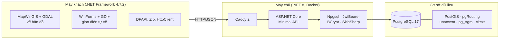

# Thư viện và công nghệ được sử dụng

Tệp này liệt kê mọi thư viện, phần mềm và dữ liệu bên ngoài mà Hue Travel dựa vào, mỗi thứ **dùng để làm gì** và **nằm ở
đâu trong dự án**. Phiên bản lấy từ các tệp cấu hình trong kho mã (`*.csproj`, `Dockerfile`, `docker-compose.yml`, migration).

Mục lục: [1. Cơ sở dữ liệu](#1-cơ-sở-dữ-liệu) · [2. Máy chủ API](#2-máy-chủ-api-may-chuapi) · [3. Máy khách Windows](#3-máy-khách-windows-may-khachung-dung) ·
[4. Hạ tầng và đóng gói](#4-hạ-tầng-và-đóng-gói) · [5. Kiểm thử](#5-kiểm-thử-và-kiểm-tra-chất-lượng) · [6. Dữ liệu, phông chữ, dịch vụ ngoài](#6-dữ-liệu-phông-chữ-và-dịch-vụ-bên-ngoài)

---

## 1. Cơ sở dữ liệu

| Thành phần | Phiên bản | Vai trò trong dự án |
|---|---|---|
| **PostgreSQL** | 17 | Hệ quản trị cơ sở dữ liệu duy nhất; lưu tài khoản, địa điểm, ảnh, đánh giá và toàn bộ dữ liệu bản đồ |
| **PostGIS** | 3.5 | Thêm kiểu dữ liệu không gian (`geometry`) và hàm không gian (`st_distance`, `st_linelocatepoint`, `st_transform`…). Dùng để lưu vị trí địa điểm, ranh giới tỉnh/xã, hình dạng đường; tìm "địa điểm này nằm trong xã nào", "đường nào gần nhất" |
| **pgRouting** | 3.8 | Tính **đường đi ngắn nhất theo đường bộ thật** trên mạng đường. Xem [pgrouting.md](pgrouting.md) |
| `unaccent` | đi kèm PostgreSQL | Bỏ dấu tiếng Việt, để tìm "dai noi" ra "Đại Nội" (cột `poi.ten_khong_dau`) |
| `pg_trgm` | đi kèm PostgreSQL | Chỉ mục tìm gần đúng theo cụm 3 ký tự, làm tìm kiếm tên địa điểm nhanh |
| `citext` | đi kèm PostgreSQL | Kiểu chữ không phân biệt hoa thường, dùng cho `app_user.username` |
| `shp2pgsql` (gói `postgis`) | đi kèm | Công cụ dòng lệnh nạp tệp shapefile vào cơ sở dữ liệu khi chạy `co-so-du-lieu/run.sh` |
| `psql` | đi kèm | Chạy migration `V001`–`V010` và script nhập dữ liệu |

Các phần mở rộng được bật ngay ở migration `V001__extensions_and_helpers.sql`. Máy chủ dùng bản PostgreSQL 17 chính thức
(`postgres:17-bookworm`) cài thêm `postgresql-17-postgis-3` và `postgresql-17-pgrouting` (`may-chu/docker-csdl/Dockerfile`).
Phiên bản PostGIS và pgRouting ghi ở trên là bản đã dùng để thử trên máy phát triển; bản trong Docker là bản mới nhất của kho
apt PostgreSQL tại thời điểm dựng ảnh.

---

## 2. Máy chủ API (`may-chu/api`)

Viết bằng **C# trên .NET 8**. Các gói NuGet khai báo trong `Hue_travel.Api.csproj`:

| Thư viện | Phiên bản | Vai trò trong dự án |
|---|---|---|
| **ASP.NET Core 8** (Minimal API, Kestrel) | 8.0 | Khung chạy API HTTP: định tuyến `/v1/...`, nhận JSON, giới hạn kích thước yêu cầu, xử lý lỗi theo chuẩn ProblemDetails |
| **Npgsql** | 8.0.5 | Trình điều khiển PostgreSQL cho .NET; mọi truy vấn SQL (kể cả gọi hàm pgRouting) đi qua đây, dùng tham số hóa để chống SQL injection |
| **Microsoft.AspNetCore.Authentication.JwtBearer** | 8.0.10 | Kiểm tra mã truy cập JWT (sống 15 phút) trong mỗi yêu cầu; nhận ra vai trò `user`/`owner`/`admin` |
| **BCrypt.Net-Next** | 4.0.3 | Băm mật khẩu bằng bcrypt khi đăng ký và so sánh khi đăng nhập; không lưu mật khẩu thật |
| **SkiaSharp** | 2.88.9 | Đọc, xoay theo EXIF, nén lại ảnh địa điểm thành JPEG tối đa 1600 px, nền trắng, trước khi lưu (`Photos/PhotoEndpoints.cs`) |
| **SkiaSharp.NativeAssets.Linux.NoDependencies** | 2.88.9 | Bản thư viện gốc của SkiaSharp cho Linux **không cần cài thêm gói hệ thống**, để chạy trong container |

Các thành phần có sẵn trong .NET 8, không cần gói thêm, nhưng đóng vai trò quan trọng:

| Thành phần | Dùng để |
|---|---|
| `System.Security.Cryptography` (ECDSA P-256) | **Ký mọi phản hồi** `/v1` để máy khách kiểm tra dữ liệu không bị sửa giữa đường (`Security/ResponseSigning.cs`) |
| `Microsoft.AspNetCore.RateLimiting` | Giới hạn số yêu cầu mỗi phút (chung, đăng nhập, tác vụ nặng) chống dò mật khẩu và quá tải |
| `IMemoryCache` | Nhớ tạm trạng thái tài khoản 20 giây (khóa, hạ quyền) và thời tiết 15 phút, tránh truy vấn và gọi ngoài lặp lại |
| `IHttpClientFactory` | Gọi dịch vụ thời tiết Open-Meteo ngoài |
| `System.Text.Json` | Đọc và ghi JSON, kể cả GeoJSON của tuyến đường |

Mã tự viết đáng chú ý: `Routing/RouteOptimizer.cs` (sắp xếp thứ tự điểm dừng bằng quy hoạch động Held-Karp, tối đa 12 điểm).

---

## 3. Máy khách Windows (`may-khach/ung-dung`)

Viết bằng **C# trên .NET Framework 4.7.2**, ứng dụng WinForms 32-bit (do MapWinGIS là 32-bit).

| Thư viện | Vai trò trong dự án |
|---|---|
| **MapWinGIS** (điều khiển ActiveX `MapWinGIS.ocx`, kèm **GDAL**) | Trái tim phần bản đồ: đọc tệp shapefile, vẽ lớp bản đồ nền (đường, sông, ranh giới, địa danh), vẽ điểm địa điểm, tuyến đường, công cụ đo khoảng cách và diện tích, phóng/thu. Bộ cài đăng ký sẵn bằng `regsvr32` |
| `Interop.MapWinGIS.dll`, `AxInterop.MapWinGIS.dll` (thư mục `lib/`) | Lớp bọc .NET do công cụ sinh ra để C# gọi được điều khiển MapWinGIS và nhúng nó vào cửa sổ |
| **Windows Forms** + **System.Drawing (GDI+)** | Toàn bộ giao diện. Các thành phần (nút, danh sách, thẻ, ô nhập, thanh tab…) được **tự vẽ** để có kiểu riêng của dự án (`Theme/`, `Account/AccountKit.cs`, `Account/ItemList.cs`) |
| **System.Net.Http** | Gọi API máy chủ (`Services/Online/ApiClient.cs`), tự làm mới mã đăng nhập khi gặp 401, kiểm tra chữ ký phản hồi |
| **System.Web.Extensions** (`JavaScriptSerializer`) | Đọc và ghi JSON, gói trong `JsonHelper` |
| **System.Security** (DPAPI `ProtectedData`) | Mã hóa phiên đăng nhập lưu trên máy: chỉ đúng người dùng Windows đó đọc được (`Services/Online/TokenStore.cs`) |
| **System.IO.Compression** | Giải nén gói bản đồ nền tải từ máy chủ (`Services/Data/BaseMapStore.cs`, `Services/Online/BaseMapUpdater.cs`), kiểm tra SHA-256 từng tệp |
| P/Invoke `user32` / `gdi32` | Nạp phông chữ nhúng (`AddFontMemResourceEx`), kéo cửa sổ không viền (`Theme/FontLoader.cs`, `Shell/TitleBar.cs`) |
| **Guna.UI2.WinForms** 2.0.4.6 | ⚠ Được khai báo trong `Hue_travel.csproj` nhưng **không còn dòng mã nào dùng**; giao diện đã tự vẽ hoàn toàn. Có thể gỡ để bộ cài nhẹ hơn (~2 MB) và bớt rủi ro giấy phép |

---

## 4. Hạ tầng và đóng gói

| Công cụ | Vai trò trong dự án |
|---|---|
| **Docker + Docker Compose** | Chạy cả máy chủ trên một VPS Ubuntu bằng một lệnh: cơ sở dữ liệu, API, Caddy (`may-chu/docker-compose.yml`) |
| **Caddy 2** (`caddy:2`) | Cổng vào cổng 80: chuyển yêu cầu tới API, **phục vụ tệp bản đồ nền** thẳng từ đĩa (có bộ nhớ đệm một năm theo phiên bản), nén zstd/gzip |
| `mcr.microsoft.com/dotnet/sdk:8.0` / `aspnet:8.0` | Hai tầng dựng ảnh Docker của API: tầng SDK biên dịch, tầng `aspnet` nhỏ gọn để chạy |
| `python:3.12-slim` | Chỉ để chạy một lần `scripts/pack-basemap.py`: nén dữ liệu bản đồ nền thành gói cho máy khách tải |
| Script `deploy.sh`, `backup.sh`, `restore.sh`, `setup-vps.sh` | Triển khai, cập nhật có tự quay lui, sao lưu hằng ngày, khôi phục, cài VPS |
| **Inno Setup 6** (`HueTravel.iss`) | Dựng bộ cài `HueTravel-Setup-<phiên bản>.exe`: chép ứng dụng và MapWinGIS, đăng ký OCX, hỏi địa chỉ máy chủ, tạo lối tắt, gỡ cài đặt sạch |
| **MSBuild** (Visual Studio 2019/2022 hoặc Build Tools) | Dựng ứng dụng WinForms (`may-khach/dong-goi.ps1`) |
| **GitHub Actions** | CI: `actions/checkout`, `actions/setup-dotnet`, `microsoft/setup-msbuild`, `gitleaks/gitleaks-action` (quét lộ khóa bí mật), `softprops/action-gh-release` (phát hành tệp) |
| **Dependabot** | Mỗi tuần tự đề xuất cập nhật gói NuGet, GitHub Actions và Docker (`.github/dependabot.yml`) |

---

## 5. Kiểm thử và kiểm tra chất lượng

| Công cụ | Phiên bản | Vai trò |
|---|---|---|
| **xUnit** | 2.9.2 | Khung kiểm thử máy chủ (`may-chu/kiem-thu`) |
| `xunit.runner.visualstudio` | 2.8.2 | Cho `dotnet test` và Visual Studio chạy được xUnit |
| `Microsoft.NET.Test.Sdk` | 17.11.1 | Nền chạy kiểm thử .NET |
| **Microsoft.AspNetCore.Mvc.Testing** | 8.0.10 | Dựng nguyên API trong bộ nhớ để kiểm thử qua HTTP thật, gồm đăng nhập, phân quyền, đánh giá, ảnh, tìm đường |
| Kịch bản PowerShell (`may-khach/kiem-thu/test_services.ps1`) | | Kiểm thử các dịch vụ của máy khách bằng cách nạp trực tiếp `Hue_travel.exe` (PowerShell 32-bit) |

Các bài kiểm thử cơ sở dữ liệu cần biến môi trường `HUE_TEST_DB` trỏ tới một cơ sở dữ liệu đã dựng sẵn; không có thì tự bỏ qua.

---

## 6. Dữ liệu, phông chữ và dịch vụ bên ngoài

| Thứ | Nguồn / giấy phép | Vai trò |
|---|---|---|
| **OpenStreetMap** (hình học đường, sông) | © OpenStreetMap contributors, ODbL 1.0 (phải ghi nguồn) | Gốc của mạng đường dùng để tìm đường và vẽ bản đồ nền |
| Dữ liệu địa điểm, ranh giới tỉnh/xã | Dữ liệu của dự án (`may-chu/du-lieu/shp`, `nen-ban-do`) | Nội dung các bảng `poi`, `ranh_tinh`, `ranh_xa`… |
| **Open-Meteo** | CC BY 4.0, miễn phí phi thương mại (phải ghi nguồn) | Thời tiết hiện tại, máy chủ gọi rồi nhớ tạm để máy khách không gọi trực tiếp |
| **Plus Jakarta Sans** (4 độ đậm) | SIL Open Font License 1.1 | Phông chữ của toàn bộ giao diện, nhúng sẵn trong ứng dụng |
| **Material Symbols Outlined** (bản con ~60 biểu tượng) | Apache License 2.0 | Phông biểu tượng (kính lúp, sao, khóa, chuông…) |
| Địa chỉ tile bản đồ Google | Còn trong `MapEngine/BaseMapCatalog.cs` nhưng **đã tắt** (`UseLocalData = true`) | Không dùng; bản đồ nền vẽ từ dữ liệu của dự án |

Chi tiết nguồn và giấy phép của tài nguyên nhúng nằm ở `may-khach/ung-dung/Resources/LICENSES.md`.
